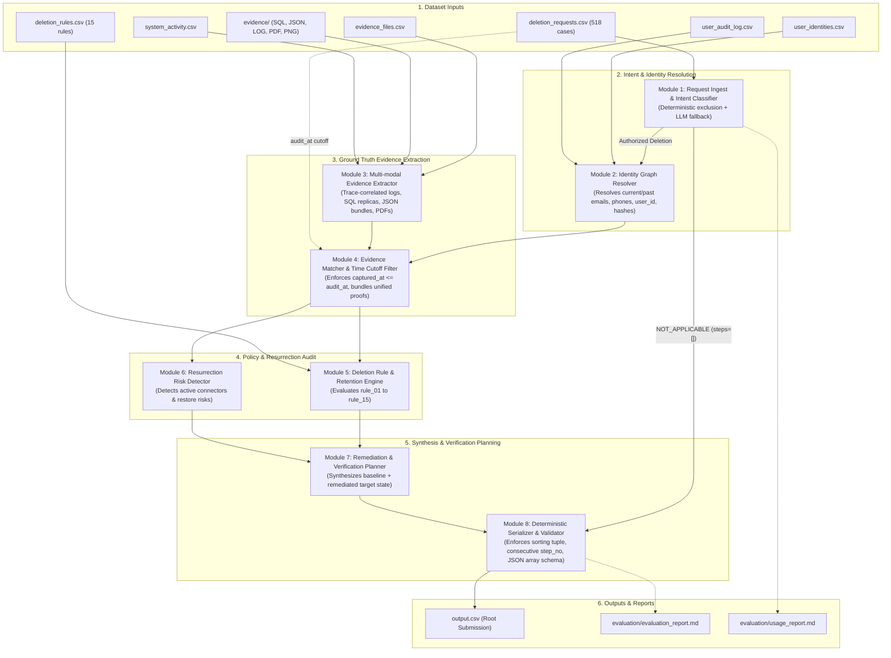

# System Architecture: AI-Powered Deletion Audit Agent
**Challenge:** HackerRank Orchestrate (October 2026) — *Ghost Data Still Exists*  
**Date:** 2026-10-25  
**Status:** Architecture Blueprint (Validated & Refined)  

---

## 1. Architectural Philosophy & Strategy

Auditing data deletions across distributed corporate systems requires absolute accuracy, referential consistency, and auditable proof. Flaky or non-deterministic hallucinations in audit findings can lead to regulatory penalties or critical data loss.

### Core Architectural Decisions:
1. **Deterministic-First Core:** 
   Structured data parsing, identity resolution across graph aliases, SQL replica comparison, timestamp filtering, policy rule mapping, and step sorting are implemented in **pure, deterministic Python**.
2. **Targeted Agentic / LLM Reasoning:**
   LLM calls are reserved strictly for:
   - **Intent Classification Fallback:** Parsing ambiguous natural language requests in `request_text` that cannot be resolved via deterministic exclusion rules.
   - **Visual Evidence Fallback:** Interpreting UI screenshots (11 `.png` images) when visual artifact data is not replicated in structured logs or snapshots.
3. **Strict Cutoff Enforcement (`audit_at`):**
   Every evidence record, log entry, activity log, and snapshot is filtered at or before `audit_at`. Evidence captured after `audit_at` is unconditionally discarded for that case.
4. **Zero-Hallucination Evidence Citing:**
   Every cited `evidence_id` in `COMPLETE` verifications and `INCOMPLETE` findings maps to an existing file in `dataset/evidence/` or an explicit activity/audit ID. Proposed remediation and post-remediation verification steps strictly enforce `evidence_id: ""`.

---

## 2. End-to-End System Architecture



---

## 3. Module Specifications & Refinements

### Module 1: Request Ingestion & Intent Classifier (`RequestClassifier`)
- **Responsibility:**
  Parses `deletion_requests.csv` and inspects `request_text`. Evaluates whether the request explicitly authorizes deletion, or represents an orthogonal action (such as a data export, address/phone update, marketing opt-out, or invoice request) resulting in `NOT_APPLICABLE`.
- **Refined Logic (Correction 4):**
  1. **Deterministic Exclusion Phrases:** Evaluates regex/clause patterns where users explicitly decline deletion or request account continuation:
     - `"leave the account active"`
     - `"not asking for deletion"`
     - `"keep the account as it is"`
     - `"leave my profile and purchase history in place"`
     - `"continue using the service"`
     - If any exclusion pattern matches &rarr; instantly returns `is_deletion_authorized = False` (`NOT_APPLICABLE`).
  2. **Deterministic Deletion Authorization Verbs:** Evaluates multilingual deletion keywords across English, French, Spanish, German, Japanese, Korean, and Portuguese (`delete`, `remove`, `erase`, `close`, `supprimer`, `exclusão`, `eliminar`, `löschen`, `削除`, `삭제`).
  3. **LLM Fallback:** Only ambiguous phrasing without clear authorization or exclusion triggers an LLM classification call.
- **Input:** `case_id`, `email`, `request_text`, `requested_at`.
- **Output:** `is_deletion_authorized: bool`, `request_category: Enum('DELETE', 'EXPORT_ONLY', 'UPDATE_ONLY', 'MARKETING_OPTOUT_ONLY', 'INVOICE_COPY_ONLY')`.
- **Dependencies:** Standard library `re`, optional lightweight LLM client.

---

### Module 2: Identity Graph Resolver (`IdentityResolver`)
- **Responsibility:**
  Reconstructs the full identity cluster for the subject of each case across historical changes.
- **Logic:**
  1. Primary lookup: Match request `email` in `user_identities.csv`.
  2. Historical lookup: If not in `user_identities.csv` or to discover aliases, search `user_audit_log.csv` for `field_name == 'email'` matching `old_value` or `new_value`.
  3. Extract stable canonical `user_id`.
  4. Aggregate all aliases:
     - All historical and current email addresses.
     - All phone numbers (current and audit log).
     - All SHA-256 email hashes (computed and audit log).
     - Full names and known variations.
- **Input:** Request `email`, `user_identities.csv`, `user_audit_log.csv`.
- **Output:** `IdentityCluster`:
  ```python
  @dataclass
  class IdentityCluster:
      user_id: str
      names: Set[str]
      emails: Set[str]
      phones: Set[str]
      email_hashes: Set[str]
  ```
- **Dependencies:** `pandas`, `hashlib`.

---

### Module 3: Multi-modal Evidence Extractor (`EvidenceExtractor`)
- **Responsibility:**
  Normalizes disparate raw evidence formats into standardized in-memory records, maintaining lifecycle context across distributed event traces.
- **Refined Sub-parsers (Correction 1 - Log Trace Correlation):**
  - **System Logs (`evidence/logs/*.log`):**
    Observability event streams frequently decouple subject identification and resource outcomes across separate lines.
    *Extractor Logic:* Maintained an active correlation map keyed by `(service, trace_id)` within each log file. Line 1 (e.g. `event=connector_config_read_started subject_key="lucia-torres@gmail.com" trace_id=tr-9750867`) supplies identity context; Line 2 (e.g. `event=connector_heartbeat resource_id=data_flow_9846 enabled=true trace_id=tr-9750867`) supplies the resource state. The parser unifies these lines into a complete `StandardizedEvidenceRecord`.
  - **SQL Snapshots (`evidence/databases/*.sql`):** 
    Executes `.sql` dumps in SQLite in-memory databases. Compares tables across `customer_profiles_primary`, `customer_profiles_failover_replica`, `customer_profiles_regional_replicas`, and `customer_data_read_replica` to detect replication drift.
  - **Structured Records (`evidence/records/*.json` & `*.txt`):** 
    Parses JSON snapshot bundles, analytics profiles, and shift handover text logs (`customer_account_handover_20261001.txt`). Extracts `user_id`, `email`, `phone`, `email_hash`, `account_status`, `data_flow`, `resource_id`.
  - **Documents (`evidence/documents/*.pdf`):** 
    Extracts text using PyMuPDF (`fitz`). Scans for user references, orders, delivery correction tickets, and legal retention registers.
  - **Images (`evidence/images/*.png`):** 
    Targeted visual inspector. Invoked as fallback if a user resource is referenced in an image file manifest or activity log without structured text backing.
- **Input:** `evidence_files.csv`, files in `dataset/evidence/`, `system_activity.csv`.
- **Output:** Collection of `StandardizedEvidenceRecord`:
  ```python
  @dataclass
  class StandardizedEvidenceRecord:
      evidence_id: str          # file_id or activity_id or audit_id
      system_id: str            # account_service, search_service, etc.
      resource_id: str          # account_005, search_001, etc.
      data_category: str        # USER_PROFILE, SEARCH_INDEX_ENTRY, etc.
      captured_at: str          # ISO-8601 UTC
      observed_state: str       # PRESENT, ABSENT, REDACTED, ANONYMIZED, ACTIVE, BLOCKED
      exposed_pii: Dict[str, Any] # Extracted matching identifiers
      details: str
  ```
- **Dependencies:** `sqlite3`, `json`, `fitz` (PyMuPDF), `re`.

---

### Module 4: Ground Truth Evidence Matcher (`EvidenceMatcher`)
- **Responsibility:**
  Correlates the `IdentityCluster` against the standardized evidence corpus while strictly enforcing the temporal boundary `audit_at`.
- **Refined Logic (Correction 3 - Unified Evidence Bundling):**
  1. **Strict Temporal Cutoff Filter:** Discards any evidence record or log where `captured_at > request.audit_at`.
  2. **Identifier Correlation:** Matches records where `record.exposed_pii` overlaps with `IdentityCluster.emails`, `phones`, `names`, `email_hashes`, or explicit `user_id` foreign keys.
  3. **Evidence Bundling Priority for `COMPLETE` Cases:**
     When multiple evidence files contain observations for a user, `EvidenceMatcher` prioritizes citing the **single comprehensive snapshot / bundle file** captured prior to `audit_at` (e.g. `service_resource_export`, `customer_data_snapshot_bundle`, `service_readback_logs`). This ensures that all verification steps for a complete case consistently cite the unified proof document (matching ground truth behavior in `case_03`, `case_25`, `case_26`, `case_31`).
  4. **Claim vs. Reality Reconciliation:** Reconciles workflow claims (`reported_status`) against actual state in the latest evidence prior to `audit_at`.
- **Input:** `IdentityCluster`, `audit_at`, collection of `StandardizedEvidenceRecord`.
- **Output:** Filtered, verified dictionary of current resource states for the user.
- **Dependencies:** `datetime`, `pandas`.

---

### Module 5: Deletion Rule & Retention Engine (`RuleEngine`)
- **Responsibility:**
  Applies `deletion_rules.csv` to determine compliance violations and retention obligations.
- **Logic:**
  - Evaluates each discovered resource against the 15 deletion rules:
    * `USER_PROFILE`, `SECONDARY_IDENTIFIER`, `SEARCH_INDEX_ENTRY`, `CACHE_ENTRY`, `SUPPORT_ATTACHMENT`, `USER_EXPORT`, `MARKETING_PROFILE` &rarr; Must be `DELETE` (`ABSENT`).
    * `SUPPORT_MESSAGE`, `EMAIL_DELIVERY_LOG` &rarr; Must be `REDACT` (`REDACTED`).
    * `ANALYTICS_PROFILE`, `PRODUCT_TELEMETRY` &rarr; Must be `ANONYMIZE` (`ANONYMIZED`).
    * `SECURITY_AUDIT_LOG`, `LEGAL_HOLD_RECORD`, `BACKUP_ARCHIVE` &rarr; Must be `RETAIN` (`PRESENT`).
    * `ACCOUNT_TOMBSTONE` &rarr; Must be `REDACT` (`REDACTED` with stable `user_id` retained).
  - Flags any discrepancy as a `FINDING`:
    * Record exists that should be deleted &rarr; `REPORT_REMAINING_RECORD` (State: `PRESENT`).
    * Record exists that should be redacted/anonymized but retains PII &rarr; `REPORT_EXPOSED_PII` (State: `PRESENT`).
- **Input:** Matched resources, `deletion_rules.csv`.
- **Output:** List of verified compliant resources vs. identified policy violations.
- **Dependencies:** Rule definitions.

---

### Module 6: Resurrection Risk Detector (`ResurrectionDetector`)
- **Responsibility:**
  Discovers active synchronization processes and unblocked backup restores that could re-inject deleted personal data into production systems.
- **Logic:**
  - Scans `integration_service` configurations and logs for active connectors linked to user profile/events &rarr; `REPORT_ACTIVE_DATA_FLOW` (State: `ACTIVE`).
  - Scans `backup_service` registers for retained backups covering user data that lack restore blocks &rarr; `REPORT_RESTORE_RISK` (State: `ACTIVE`).
- **Input:** Matched integration and backup records, `system_activity.csv`.
- **Output:** Resurrection risk findings.
- **Dependencies:** `EvidenceMatcher`.

---

### Module 7: Remediation & Verification Planner (`RemediationPlanner`)
- **Responsibility:**
  Builds the required sequences of remediation actions and post-remediation verification checks for `INCOMPLETE` cases, or verification proofs for `COMPLETE` cases.
- **Refined Logic (Correction 2 - Comprehensive Verification Scope):**
  - **For `COMPLETE` Cases:**
    - Generates **only** `VERIFICATION` phase steps.
    - Every step cites the actual `evidence_id` that proves the compliant state.
  - **For `INCOMPLETE` Cases:**
    - Generates `FINDING` steps citing verified `evidence_id`.
    - Generates `REMEDIATION` steps (`evidence_id: ""`):
      * Halts data flows (`DISABLE_DATA_FLOW`) and blocks restores (`BLOCK_RESTORE`) before cleaning records.
      * Issues record deletion (`DELETE_RECORD`), redaction (`REDACT_RECORD`), or anonymization (`ANONYMIZE_RECORD`).
    - Generates `VERIFICATION` steps (`evidence_id: ""`):
      * Synthesizes the **complete target compliant state** across all discovered subject resources:
        1. Primary account absence: `account_service:account_XXXX` (`VERIFY_RECORD_ABSENT`).
        2. Retained compliance records: `security_service:audit_record_XXXX` (`VERIFY_RECORD_PRESENT`) or legal hold records.
        3. Preserved tombstones: `identity_service:tombstone_XXXX` (`VERIFY_RECORD_REDACTED`).
        4. Remediated secondary records: search index absence, support redaction, analytics anonymization.
        5. Remediated data flows & backups: `VERIFY_DATA_FLOW_DISABLED` and `VERIFY_RESTORE_BLOCKED`.
      * **All** post-remediation verification steps in `INCOMPLETE` cases strictly enforce `evidence_id: ""`.
- **Input:** Compliance violations, resurrection risks, verified baseline resources.
- **Output:** Raw list of un-ordered step dictionaries.
- **Dependencies:** Canonical operation catalog.

---

### Module 8: Deterministic Serializer & Validator (`OutputSerializer`)
- **Responsibility:**
  Enforces strict canonical step ordering, step numbering, JSON array serialization, and CSV output structure.
- **Ordering Algorithm:**
  ```python
  PHASE_ORDER = {"FINDING": 0, "REMEDIATION": 1, "VERIFICATION": 2}

  OPERATION_ORDER = {
      # Finding operations
      "REPORT_REMAINING_RECORD": 0,
      "REPORT_EXPOSED_PII": 1,
      "REPORT_ACTIVE_DATA_FLOW": 2,
      "REPORT_RESTORE_RISK": 3,
      # Remediation operations
      "DISABLE_DATA_FLOW": 0,
      "BLOCK_RESTORE": 1,
      "DELETE_RECORD": 2,
      "REDACT_RECORD": 3,
      "ANONYMIZE_RECORD": 4,
      # Verification operations
      "VERIFY_RECORD_ABSENT": 0,
      "VERIFY_RECORD_PRESENT": 1,
      "VERIFY_RECORD_REDACTED": 2,
      "VERIFY_RECORD_ANONYMIZED": 3,
      "VERIFY_DATA_FLOW_DISABLED": 4,
      "VERIFY_RESTORE_BLOCKED": 5,
  }

  def sort_steps(steps: List[Dict[str, Any]]) -> List[Dict[str, Any]]:
      def sort_key(s):
          return (
              PHASE_ORDER[s["phase"]],
              OPERATION_ORDER[s["operation"]],
              s["system_id"],
              s["resource_id"]
          )
      sorted_list = sorted(steps, key=sort_key)
      for idx, step in enumerate(sorted_list, start=1):
          step["step_no"] = idx
      return sorted_list
  ```
- **Validation Checks:**
  - Exact header: `case_id,deletion_status,steps_json`.
  - Exactly 518 data rows sorted ascending by `case_id`.
  - `deletion_status` in `['COMPLETE', 'INCOMPLETE', 'NOT_APPLICABLE']`.
  - For `NOT_APPLICABLE`, `steps_json == "[]"`.
  - Step numbers consecutive integers starting from 1.
  - Verification in `COMPLETE` has non-empty `evidence_id`; remediation and future verification in `INCOMPLETE` has `evidence_id == ""`.
- **Input:** Case results.
- **Output:** Root `output.csv`.
- **Dependencies:** `csv`, `json`.

---

### Module 9: Evaluation & Usage Accounting (`EvaluationWorkflow`)
- **Responsibility:**
  Executes validation against `sample_output.csv`, runs custom evaluation benchmarks, and logs token/cost metrics into the required report files:
  - `code/evaluation/evaluation_report.md`
  - `code/evaluation/usage_report.md`
- **Output Metrics:**
  - Case-level deletion status accuracy (against 32 public sample cases).
  - Step-level and field-level precision, recall, and sequence exact-match.
  - Model call count, prompt/completion tokens, total cost breakdown.
- **Dependencies:** `code/evaluation/main.py`.

---

## 4. Exact Output Schema and Validation Constraints

### 4.1 Root Output File Specification
- **Path:** `<repo_root>/output.csv`
- **Header:** `case_id,deletion_status,steps_json`
- **Row Count:** Exactly 518 data rows + 1 header row.
- **Sorting:** Sorted ascending by `case_id` (`case_33` through `case_550`).

### 4.2 Status Contract
| Status | When Applicable | `steps_json` Structure | Evidence ID Rule |
| :--- | :--- | :--- | :--- |
| `NOT_APPLICABLE` | User requested non-deletion action (access, export, phone update, marketing opt-out). | Strictly `[]` | No steps permitted. |
| `COMPLETE` | All required records deleted/redacted/anonymized before `audit_at`, no resurrection risks, retentions intact. | Only `VERIFICATION` steps. | Every step **must** cite a valid `evidence_id` (`file_id`, `activity_id`, or `audit_id`). |
| `INCOMPLETE` | Unfinished deletions, unredacted tombstones, active sync flows, or unblocked restores exist at `audit_at`. | `FINDING` &rarr; `REMEDIATION` &rarr; `VERIFICATION`. | Findings cite valid `evidence_id`. Remediation and post-remediation verification **must** use `evidence_id: ""`. |

### 4.3 Step Object JSON Schema
```json
{
  "step_no": 1,
  "phase": "FINDING",
  "system_id": "account_service",
  "resource_id": "account_005",
  "operation": "REPORT_REMAINING_RECORD",
  "state": "PRESENT",
  "evidence_id": "evidence_54"
}
```

### 4.4 Allowed Step Operations and Allowed States (Closed Set)
| Phase | Operation | Allowed State | Meaning |
| :--- | :--- | :--- | :--- |
| **`FINDING`** | `REPORT_REMAINING_RECORD` | `PRESENT` | Record that should have been deleted still exists. |
| | `REPORT_EXPOSED_PII` | `PRESENT` | Record may remain, but contains unredacted/unanonymized direct PII. |
| | `REPORT_ACTIVE_DATA_FLOW` | `ACTIVE` | An active process/connector can sync or recreate data. |
| | `REPORT_RESTORE_RISK` | `ACTIVE` | A backup/restore path can bring deleted data back. |
| **`REMEDIATION`** | `DISABLE_DATA_FLOW` | `DISABLED` | Halt the active synchronization flow. |
| | `BLOCK_RESTORE` | `BLOCKED` | Restrict backup restore access for this subject. |
| | `DELETE_RECORD` | `ABSENT` | Remove the record completely. |
| | `REDACT_RECORD` | `REDACTED` | Strip direct identifiers while retaining necessary context. |
| | `ANONYMIZE_RECORD` | `ANONYMIZED` | Irreversibly unlink record from user identity. |
| **`VERIFICATION`** | `VERIFY_RECORD_ABSENT` | `ABSENT` | Confirm record no longer exists. |
| | `VERIFY_RECORD_PRESENT` | `PRESENT` | Confirm policy-required retained record still exists. |
| | `VERIFY_RECORD_REDACTED` | `REDACTED` | Confirm required identifying fields are removed. |
| | `VERIFY_RECORD_ANONYMIZED` | `ANONYMIZED` | Confirm record is unlinkable to subject. |
| | `VERIFY_DATA_FLOW_DISABLED` | `DISABLED` | Confirm data flow is inactive. |
| | `VERIFY_RESTORE_BLOCKED` | `BLOCKED` | Confirm affected backup cannot restore data. |

---

## 5. Remaining Ambiguities, Unsupported Assumptions & Mitigations

| Issue / Ambiguity | Challenge / Risk | Architecture Mitigation |
| :--- | :--- | :--- |
| **1. UI Image Evidence (`.png`) vs Structured Data** | 11 `.png` images exist under `evidence/images/`. In `sample_output.csv`, zero of the 32 sample cases cite an image evidence ID. It is uncertain if any of the hidden 518 cases require citing an image file ID. | If an image is referenced in `system_activity.csv` or file manifest as the sole proof, `EvidenceExtractor` extracts UI text via fallback PyMuPDF image container / OCR inspection to recover the `file_id`. |
| **2. Multi-log Trace ID Scope** | Trace IDs (e.g. `tr-9750867`) could theoretically collide across separate regional log files. | Key the trace correlation dictionary by `(file_id, service, trace_id)` so correlation is strictly localized to the specific file and service instance. |
| **3. Account Resource ID for Pre-deleted Accounts** | In `INCOMPLETE` cases where the finding is a secondary resource (e.g. `search_service` in `case_06`), the verification phase requires verifying `account_service:account_006` (`VERIFY_RECORD_ABSENT`). | The primary `account_id` is resolved deterministically from `system_activity.csv` deletion events, handover logs, or profile lookup logs, ensuring the baseline account verification always references the correct `account_XXXX` identifier. |
| **4. Sub-case Ordering Ties** | Multiple resources in the same system under the same operation (e.g., two search records). | Alphabetical tie-breaking on `resource_id` (`s["resource_id"]`) provides 100% deterministic, reproducible ordering matching canonical samples. |
